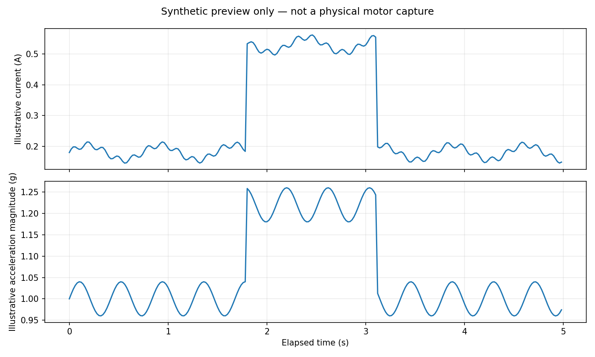

# Motor Intelligence Lab

Acquire synchronized motor-current and inertial measurements using an ESP32, then analyze the capture with a reproducible Python pipeline.

**Validation:** source and automated tests are included. Hardware compatibility depends on the exact board, sensor module and calibration. Do not claim hardware verification until you have captured and reviewed a real log.

## Telemetry preview



This plot is generated synthetic data for demonstrating the analysis layout only. It is **not** a physical motor capture or evidence of hardware validation. Replace it with a real plot after collecting a documented run.

## Hardware
- ESP32 development board (3.3 V GPIO/ADC)
- MPU6050 breakout compatible with 3.3 V I²C
- ACS712 module appropriate for expected current, or a 3.3 V-compatible current sensor
- DC motor and a driver rated for the motor's stall current
- Separate motor supply, multimeter, and preferably current-limited bench supply

## Safety
See `docs/wiring.md`. Many ACS712 boards are powered from 5 V and can output voltages above the ESP32 ADC safe range. Use a calculated divider/buffer or compatible sensor and verify voltage before connecting. Never connect a potentially 5 V output directly to an ESP32 ADC.

## Firmware
Install ESP32 board support and these Arduino libraries: Adafruit MPU6050, Adafruit Unified Sensor, Adafruit BusIO. Review the pin map and calibrate constants in `firmware/motor_intelligence_lab/motor_intelligence_lab.ino`. Compile for your exact board and open Serial Monitor at 115200 baud. Send `s` to start a capture and `x` to stop. Save numeric CSV lines; ignore lines beginning with `#`.

## Python analysis
```bash
python3 -m venv .venv
source .venv/bin/activate
pip install -r analysis/requirements.txt
python analysis/analyze_capture.py data/your_capture.csv --out results/summary.json --plot results/capture.png
python -m unittest discover -s tests -v
```

No hardware dataset is included. The test fixtures are synthetic and must never be presented as experimental evidence.

## CSV schema
| Field | Unit | Meaning |
|---|---|---|
| `time_ms` | ms | elapsed capture time |
| `ax_g`, `ay_g`, `az_g` | g | acceleration axes |
| `gx_dps`, `gy_dps`, `gz_dps` | degrees/s | angular velocity |
| `current_a` | A | estimated current after calibration |
| `adc_raw` | ADC counts | raw ADC reading |

## Interpretation
Compare runs only when supply voltage, motor, sensor calibration, mounting and sampling settings are documented. A current or vibration change alone does not prove a specific fault. Establish repeatable baselines before attempting fault classification.

## Structure
- `firmware/`: ESP32 acquisition sketch
- `analysis/`: CSV validation, metrics and plotting
- `tests/`: automated parser/metric tests
- `docs/`: wiring, experiment protocol, diagram and results template
